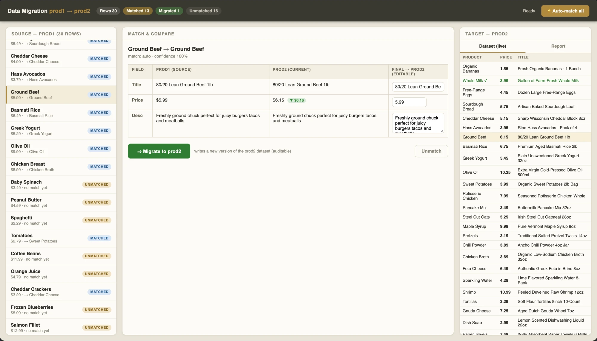
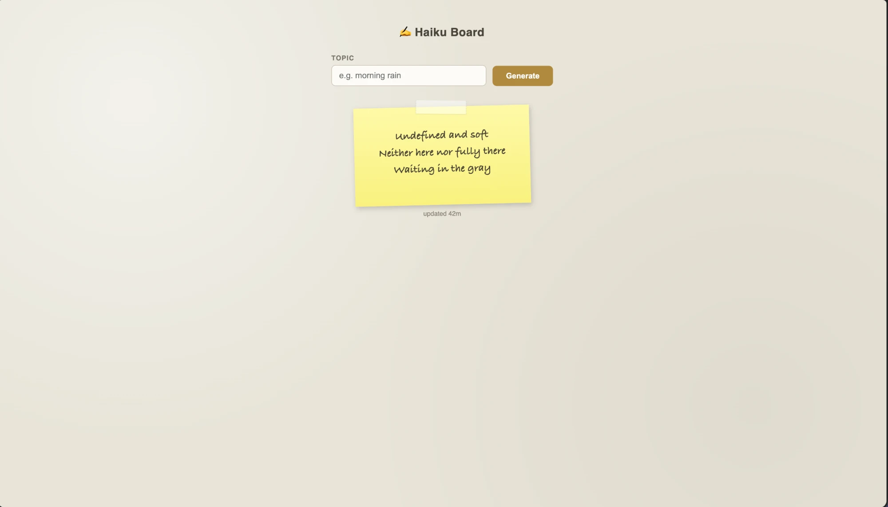

# Agent Surface Board

**A browser review board your coding agent works on, so you aren't stuck in a chat window.**
You open a tab and see the work: a draft, a set of images, a task list, a data migration.
You approve, revise, or comment, and the agent picks up your feedback in the background.
Everything lives in a local SQLite file, so closing the tab, rebooting, or crashing the
agent loses nothing.

It's for **developers who drive coding agents** (Codex, opencode, agy) and want a reviewable,
versioned place for the agent's output. You don't have to build a custom frontend for each
workflow: you describe the workflow in a small JSON "stage config" and the board renders it.



*A data-migration console built on Agent Surface. Every "Migrate" click writes a new
immutable version, so the history doubles as an audit trail.*

## Try it in 60 seconds

Requires Python 3.10+.

```bash
pip install -e ".[board]"          # the `surface` command + the web board (FastAPI, uvicorn)
surface init --stage poem          # creates .surface-board/state.sqlite3
surface serve                      # prints http://127.0.0.1:<port>/?token=... and runs until Ctrl-C
```

Open the printed URL. You'll see one card holding the poem's current text, its status, and the
actions the stage allows (approve, revise). Edit or approve it, close the tab, and run
`surface serve` again later: you're back where you left off.

That board has no agent attached, so feedback is stored but nothing rewrites it. To put a real
agent behind **revise**:

```bash
surface serve --agent codex        # or: opencode, agy
```

**Next steps:**
- **Evaluating?** Look at the [example surfaces](#what-you-can-build) below, then try a richer
  preset: `surface --db demo.sqlite3 init --stage task_board`, then `surface --db demo.sqlite3 serve`.
- **Building on it?** Read [Planning a New Surface in `SKILL.md`](SKILL.md), then the
  [stage config guide](docs/stage-config-guide.md).
- **Want the agent to drive it?** [`SKILL.md`](SKILL.md) is the behavioral spec an agent loads.

## Contents

- [What you can build](#what-you-can-build)
- [How it works](#how-it-works)
- [Bundled stage presets](#bundled-stage-presets)
- [Board features](#board-features)
- [Real agent backends](#real-agent-backends)
- [Writing a new stage config](#writing-a-new-stage-config)
- [CLI reference](#cli-reference)
- [Resuming a project (in progress)](#resuming-a-project-in-progress)
- [Development and tests](#development-and-tests)
- [Status and limitations](#status-and-limitations)

## What you can build

Every surface uses the same skeleton: board, store, supervisor, worker. Only the **worker**
and the **stage config** change from one app to the next. Two examples:

### Haiku board (minimal)

A one-box app. Type a topic, click Generate, and the worker writes a fresh haiku onto a
yellow sticky note. Each generation is an immutable version, so you get the full history of
every haiku for free. Undo is just the version table.



### Migration console (real-world)

Moves rows from one dataset to another (screenshot at the top of this page). The left column
lists source rows, matched and unmatched. The middle panel compares a matched pair field by
field, with price deltas and an editable "final" column. The right column shows the live target
dataset and a running report of matched, migrated, and unmatched counts. Each "Migrate" writes a
new version of the target, so every migration decision can be audited.

The two apps differ only in their worker (writing haiku vs. matching rows). Both plug in
through the same stage-config and worker contract.

## How it works

```
Board UI (web) ──read/write──▶ SQLite Store ◀──jobs/results── Job Poller ──▶ Providers
                                     │                                      (image/video)
                                     ▼
                                Supervisor
                                     │
                            WorkerTransport (native subprocess / resume fallback)
                                     │
                                     ▼
                            Worker (python -m surface.worker, or a real agent backend)
```

The board is a thin renderer and holds no state. Clicks become inbox events, and polling
shows fresh state. The Supervisor claims events and dispatches them to a worker. Slow
generation (images, video) runs as async jobs that the Poller tracks.

- **The store is the source of truth.** All project state lives in SQLite. Worker context is
  disposable.
- **Versions are immutable.** A revision creates a new version. Nothing is deleted.
- **Dependencies form a DAG.** Selecting a new upstream version marks descendants stale without
  destroying them. Locked descendants are flagged but not regenerated automatically.
- **Generation is always async.** Slow work becomes a job, and the worker never blocks a turn
  waiting for it.
- **Events are at-least-once and idempotent.** Versions and jobs are deduplicated by the
  originating event id, so redelivery after a crash doesn't duplicate effects.
- **Crash recovery.** `surface recover` reclaims leases and resumes in-flight work.
  `--force-reclaim` handles stuck leases.
- **The renderer is replaceable.** `board.py` builds a display model that doesn't depend on a
  renderer. `board_web.py` is the renderer that ships, but you can write others (see the
  `04-live-surface` pattern referenced from `SKILL.md`).

The store (`surface/store.py`, `surface/schema.py`) holds artifacts, versions, dependencies,
the event inbox with lease-based claiming, async jobs, budgets, and locks. You can drive all
of it from the CLI without opening the board, using `surface store ...` and `surface inbox ...`.
The full normative spec is [`docs/SPEC.md`](docs/SPEC.md).

## Bundled stage presets

All presets are in `surface/stages/`. Use them with `surface init --stage <name>`.

| Preset | What it is |
| --- | --- |
| `poem` | Minimal single-artifact example (the quickstart above) |
| `task_board` | Status-column board for agent-decomposed multi-step work |
| `movie` | Linear media pipeline: script → shots → keyframes → clips → assembly |
| `image_grid_example` | Demonstrates the `grid` view for image and video tiles |
| `project_kickoff`, `questionnaire`, `plan_review`, `document_review`, `diff_review`, `generic_media_pipeline` | Templates for common review and intake workflows |

## Board features

The web renderer (`surface/board_web.py`, FastAPI plus hand-written HTML/CSS/JS) provides:

- **Three collection views**, selected with `board_view`: `list` (flat, the default), `columns`
  (grouped by status), and `grid` (image and video tiles, each with its own version switcher).
- **Mermaid diagrams.** Fenced ` ```mermaid ` blocks in text or markdown artifacts render as
  diagrams.
- **Version diff.** Text artifacts with two or more versions get a "Compare to previous version"
  control. The server computes a line-by-line diff on each load. This isn't available for
  form, image, video, or audio content.
- **Dependency graph.** The "Dependencies" button on a card shows its upstream and downstream
  neighbors as a status-colored Mermaid graph. The graph updates live.

## Real agent backends

`surface serve --agent <name> [--agent-model <id>] [--agent-timeout <seconds>]` puts a real
coding-agent CLI behind the board's `revise` action. It goes through the production dispatch
path (`Supervisor` → `NativeStreamTransport` → `surface worker` subprocess), not a demo shim.
The backends registered in `surface/agents/registry.py` are:

- `opencode` (`surface/agents/opencode_backend.py`)
- `codex` (`surface/agents/codex_backend.py`)
- `agy` (`surface/agents/agy_backend.py`)
- `fake` (`surface/agents/fake_backend.py`) is deterministic and makes no network calls. The
  test suite uses it, and you can use it to exercise the dispatch path without a live CLI.

Model ID formats differ per backend. For example, opencode uses `opencode-go/<model-id>`. See
[`docs/agent-backends.md`](docs/agent-backends.md) for the exact invocation templates. To add a
backend, implement `AgentBackend` in `surface/agents/base.py` and register it in
`surface/agents/registry.py`.

## Writing a new stage config

Stage configs are plain JSON validated against `surface/stages/config.py`. Don't guess the
schema. Start from these two references:

1. **"Planning a New Surface"** near the top of [`SKILL.md`](SKILL.md). Work through it *before*
   you write JSON. It covers the unit of work, what depends on what, whether this is a pipeline
   or a conversation, what the user needs to see to decide, and which actions need a worker.
   The view type follows from those answers.
2. [`docs/stage-config-guide.md`](docs/stage-config-guide.md) is the schema reference. It
   includes `board_view`, which is an object with a `type` key: `{"type": "list"}`,
   `{"type": "columns"}`, or `{"type": "grid", "group_by": ..., "media_field": ...,
   "title_field": ..., "badge_fields": [...]}`. A bare string such as `"columns"` is still
   accepted and normalized automatically.

## CLI reference

`--db PATH` is a **global** flag, so it goes *before* the subcommand. It defaults to
`.surface-board/state.sqlite3`. JSON results go to stdout and diagnostics go to stderr.

```
surface [--db PATH] init --stage <preset>
surface [--db PATH] status                                 # summarize project state
surface [--db PATH] tui                                    # stdlib terminal board
surface [--db PATH] serve [--run-once] [--max-iterations N] [--no-board]
                          [--renderer {web,gradio}] [--host HOST] [--port PORT]
                          [--runtime-dir DIR] [--poll-interval SECONDS]
                          [--keep-runtime-files] [--pool-size N]
                          [--recycle-after-events N] [--recycle-after-tokens N]
                          [--agent NAME] [--agent-model ID] [--agent-timeout SECONDS]
surface [--db PATH] stop
surface [--db PATH] interrupt
surface [--db PATH] recover [--force-reclaim]

surface [--db PATH] render <preset_or_path> --data <file.json>
surface [--db PATH] wait <handle> --max <seconds>
surface [--db PATH] answer <handle> --value <json>

surface [--db PATH] store get <artifact_id>
surface [--db PATH] store list [--stage S] [--status S]
surface [--db PATH] store put-version [--artifact-id ID] [--file FILE]   # or JSON via stdin
surface [--db PATH] store select-version <artifact_id> <version_id>
surface [--db PATH] store set-status <artifact_id> <status>
surface [--db PATH] store add-dependency <upstream_id> <downstream_id>
surface [--db PATH] store graph <artifact_id>
surface [--db PATH] store job-start <artifact_id> <provider> <kind>
surface [--db PATH] store job-finish <job_id>
surface [--db PATH] store job-cancel <job_id>

surface [--db PATH] inbox next [--wait SECONDS]
surface [--db PATH] inbox ack <event_id>
surface [--db PATH] inbox fail <event_id>

surface [--db PATH] project summary
```

By default `serve` runs until Ctrl-C. Use `--run-once` or `--max-iterations N` to bound it, for
example `surface serve --no-board --max-iterations 5` for headless scripting. The board binds to
`127.0.0.1` (change it with `--host`/`--port`). Each run gets a random auth token, written under
the runtime dir (`--runtime-dir`), so there's never a fixed or guessable credential. If
fastapi/uvicorn aren't installed, `serve` logs that and runs headless.

## Resuming a project (in progress)

> **Not yet available from the CLI.** The commands in this section are designed and the
> backing `surface/launch_profile.py` module has landed, but `resume` and `app` aren't wired
> into `surface/cli.py` yet. Until they are, reopen a project with `surface --db <path> serve`.

The plan is for `surface init` and `surface serve` to record your stage, agent, and model as a
*launch profile* in the project database. Explicit flags passed to later `serve` runs update
it, and the last value used wins.

    surface resume                 # current directory
    surface resume ~/work/my-board # any project directory
    surface resume --no-browser    # print the URL only
    surface resume --with-agent    # also open your agent CLI in a new Terminal window (macOS)

If the board is already running, `resume` prints its URL and opens it. Otherwise it starts the
board with the saved settings, after checking that the configured agent CLI is on your `PATH`.

    surface app create            # writes "Open Surface Board.command" in the project (macOS)
    surface app create --force    # overwrite an existing one

Double-clicking the `.command` file resumes the project. It locates `surface` through
`$SURFACE_BIN`, then your login shell's `PATH`, then the path recorded when the file was
created. On failure, the Terminal window stays open so you can read the error. macOS may ask
you to confirm the first launch (right-click, then Open). The recorded path is specific to one
machine, so recreate the launcher on each machine instead of sharing it.

**What resume restores:** everything agent_surface owns, meaning artifacts, versions, board
items, events, and settings in `.surface-board/`. It does **not** restore your coding agent's
own conversation, because that history lives inside the agent CLI. `--with-agent` asks the CLI
to continue its most recent session. If that session is gone, you get a fresh one. Either way,
`resume` prints a short summary of the current stage, open items, and recent events that you
can paste into a new session.

## Development and tests

```bash
pip install -e ".[board]"
PYTHONPATH=. pytest -q
```

The suite runs the full stack (board/CLI → event → supervisor → worker subprocess → store)
through the production dispatch path using the `fake` backend. That verifies crash, timeout,
and recovery behavior without a live agent CLI or network access.

```
surface/
  store.py, schema.py       # SQLite store, the source of truth
  supervisor.py              # event claim/dispatch loop
  transports/                # WorkerTransport implementations
  worker.py                  # reference deterministic worker
  poller.py, providers/      # async job polling + mock generation providers
  board.py                   # display model + action handler (renderer-independent)
  board_web.py, static/      # default board renderer
  agents/                    # agent backends (opencode, codex, agy, fake) + registry
  launch_profile.py          # saved per-project launch settings (resume, in progress)
  stages/                    # stage config loader + bundled presets
  cli.py                     # surface CLI entrypoint
tests/
docs/SPEC.md                 # normative specification
docs/stage-config-guide.md   # stage config schema reference
docs/agent-backends.md       # per-backend CLI invocation details
SKILL.md                     # the behavioral spec an agent loads
ongoing/                     # per-phase build logs (STATE.md per phase)
```

## Status and limitations

Phases 0 through 5 are built and merged into `main`: the store, async jobs and events, crash
recovery, the web board with list, columns, and grid views, and real agent backends. Per-phase
notes on what shipped, what review found, and what's still rough are in
`ongoing/phase-1-2-harden-generalize/STATE.md`, `ongoing/phase-3-board-web-redesign/STATE.md`,
and `ongoing/phase-4-visual-planning-extensions/STATE.md`.

What isn't there yet:

- **Install from source only.** There's no PyPI package or packaged installer yet. You install
  with `pip install -e .` from a clone.
- **Grid view options are accepted but ignored.** `group_by`, `media_field`, `title_field`, and
  `badge_fields` pass validation, but the renderer doesn't read them yet, so tiles use default
  rendering.
- **Out of scope for now:** gantt and calendar views, saved filters, and a report builder.
  `list`, `columns`, and `grid` are the complete set of views.
- **One live-CLI test for `agy` fails in some environments** because of a stale hardcoded model
  name in the test. Product code isn't affected.
- **`--renderer gradio` is legacy.** It needs `pip install -e ".[gradio]"` with gradio
  `>=4.0,<6`. The default `web` renderer is the one under active development.
